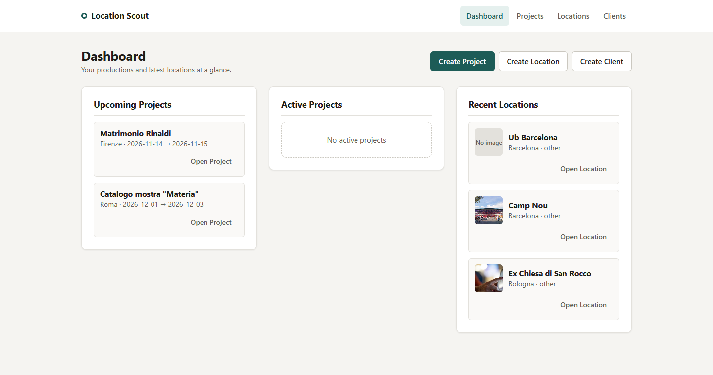
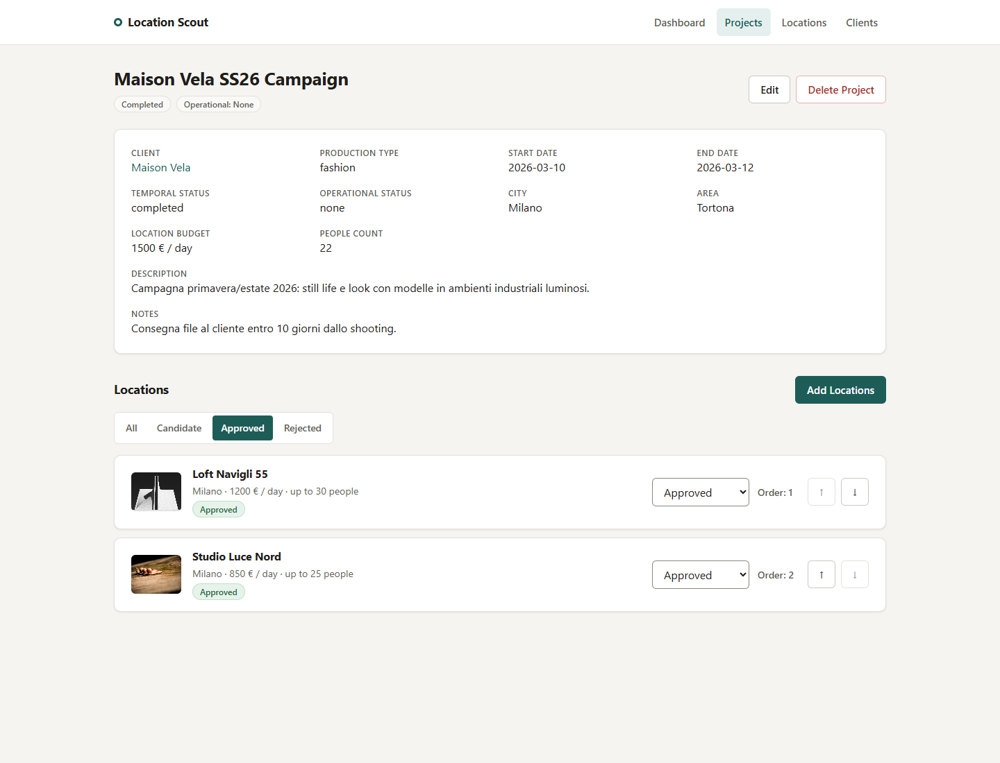
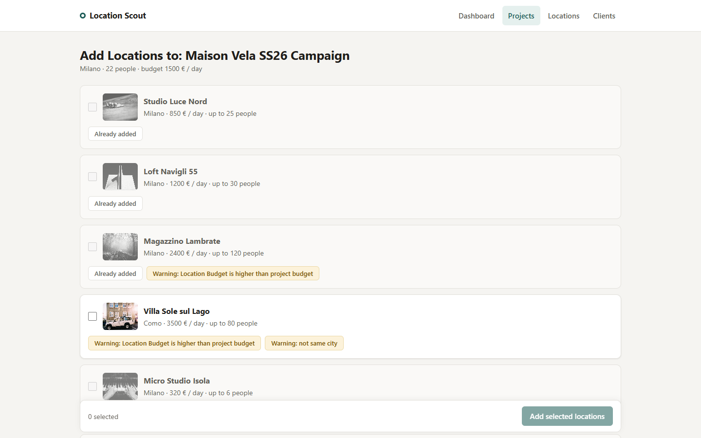
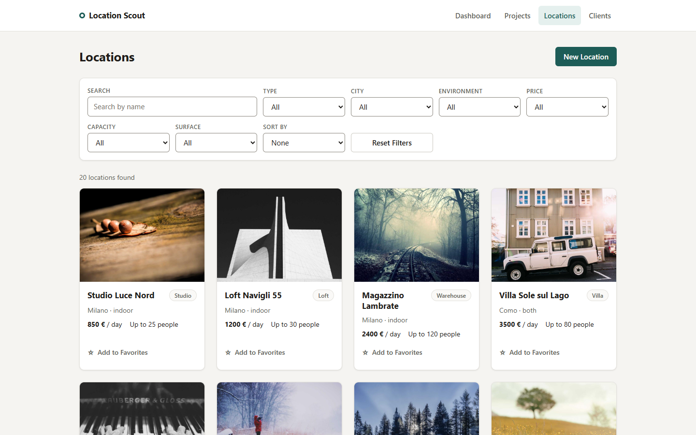
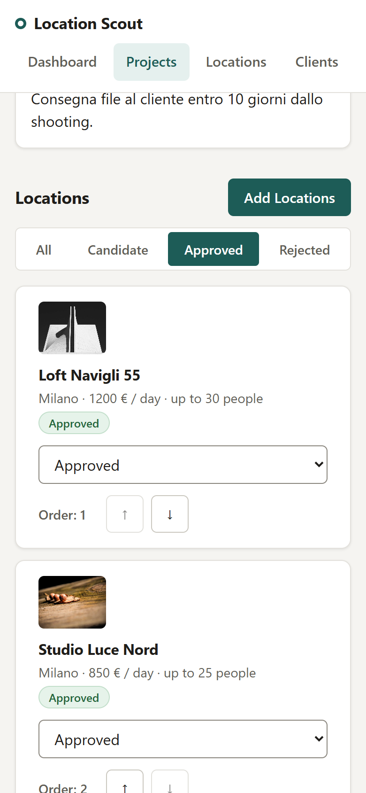

# Location Scout

A location management tool for photographers, video makers and small production agencies.
Catalogue shooting locations, plan productions for your clients, and build a shortlist of locations for each project — checking at a glance which ones fit the brief.

> **Live demo:** [location-scout-five.vercel.app](https://location-scout-five.vercel.app/)
> The demo API runs on free hosting: the first load after a quiet period can take up to a minute, and changes are reset from time to time. See [Demo limitations](#demo-limitations).



## Features

**Projects**
- Create, edit and delete projects linked to a client
- Temporal status (`upcoming` / `active` / `completed`) derived from the dates, never stored
- Operational status (`none` / `paused` / `cancelled`) for exceptions
- Search, filters (client, budget, timeline, operational status) and sorting, all kept in the URL

**Location shortlist per project**
- Dedicated page to add several locations at once, with checkboxes
- Compatibility checks against the project brief:
  - not enough capacity for the crew → selection **blocked**
  - daily price above the project budget → **warning**
  - different city → **warning**
- Each project location is a `candidate`, `approved` or `rejected`
- Approved locations get an order that can be changed with ↑ / ↓ buttons

**Locations**
- Catalogue with search, filters (type, city, environment, price, capacity, surface) and sorting
- Favorites, saved in the browser
- Detail page, create / edit / delete

**Clients**
- List, detail with the client's projects, create / edit / delete

**Data integrity**
- Deleting a client removes its projects and their location links; deleting a project or a location removes its links. Locations are never deleted by a cascade.
- Every destructive action asks for an explicit confirmation.

| Project shortlist | Add locations to a project |
| --- | --- |
|  |  |

| Locations catalogue | Mobile |
| --- | --- |
|  |  |

## Tech stack

| Area | Choice |
| --- | --- |
| UI | React 19, TypeScript, Vite |
| Routing | React Router (layout route, nested and dynamic routes, search params) |
| Server state | TanStack Query (queries, mutations, cache invalidation) |
| Client state | Zustand with `persist` (favorite locations only) |
| Mock backend | JSON Server (REST) |
| Testing | Vitest, React Testing Library, user-event, MSW |
| Quality | ESLint, TypeScript 6 (strict mode is the default) |

No UI kit and no form library: forms and styles are plain React, TypeScript and CSS.

## Getting started

Requirements: Node.js 20 or newer.

```bash
npm install
cp .env.example .env   # on Windows: copy .env.example .env
```

Start the API and the app in two terminals:

```bash
npm run server   # JSON Server on http://localhost:3001, data in db.json
npm run dev      # Vite on http://localhost:5173
```

### Environment variables

| Variable | Description | Example |
| --- | --- | --- |
| `VITE_API_URL` | Base URL of the REST API | `http://localhost:3001` |

The app stops at startup with a clear error if `VITE_API_URL` is missing. Vite inlines the value at build time, so a production build must be created with the production API URL.

## Scripts

| Command | What it does |
| --- | --- |
| `npm run dev` | Development server |
| `npm run server` | JSON Server mock API on port 3001 |
| `npm test` | Vitest in watch mode |
| `npm run test:run` | Run the test suite once |
| `npm run lint` | ESLint |
| `npm run build` | Type check and production build into `dist/` |
| `npm run preview` | Serve the production build locally |

## Testing

Tests focus on behaviour, not implementation details:

- domain utilities: temporal status, filtering and sorting
- the favorites store, including persistence and reset
- query and mutation hooks against MSW handlers (success, error, cache invalidation)
- forms: validation, error messages linked to fields, focus moved to the first invalid field
- pages: rendering after data loads
- layout: focus and document title after navigation, and the notice shown while the API wakes up

Network calls are mocked with MSW, so the suite does not need JSON Server running.

## Project structure

```text
src/
├── app/         # router, layout, QueryClient
├── pages/       # one component per route: composes features
├── features/
│   ├── projects/    # api, components, hooks, types, utils
│   ├── locations/   # ... + store (favorites)
│   ├── clients/
│   └── dashboard/
├── shared/      # domain-free pieces: config, types shared by features, hooks, components
└── test/        # test setup and MSW server
```

See [ARCHITECTURE.md](ARCHITECTURE.md) for the reasoning behind this structure.

## Key technical decisions

- **Server state vs client state.** Everything that comes from the API lives in TanStack Query. Zustand only holds favorite location ids, a browser preference that the server does not know about.
- **Derived values are not stored.** A project's temporal status and a location's compatibility with a project are computed from existing fields, so they can never get out of sync.
- **Project ↔ Location is a real entity.** `ProjectLocation` holds what belongs to the relationship (status, order, date added), not to either side.
- **Filters live in the URL.** Search, filters and sorting are search params: shareable, bookmarkable and kept on refresh. Lists are small, so filtering happens on the client without refetching.
- **Cascade deletes in the API layer.** JSON Server has no relations or transactions, so cascades are done by the frontend API functions. With a real backend this belongs to the server or the database, inside a transaction.
- **Accessibility.** Labelled controls, errors linked with `aria-describedby`, focus moved to the first invalid field, live regions for loading and errors, a page title per route, focus moved to the content after navigation, and a skip link.

## Deployment

The frontend and the API are hosted separately, both on free plans:

```text
Browser ──► Vercel  (static React build)  https://location-scout-five.vercel.app
   │
   └──────► Render  (JSON Server API)     https://location-scout-api.onrender.com
```

| Part | Host | Config | What it runs |
| --- | --- | --- | --- |
| Frontend | [Vercel](https://vercel.com) | [`vercel.json`](vercel.json) | `npm run build`, serving `dist/`. Every path is rewritten to `index.html`, so React Router handles refreshes and deep links such as `/projects/1` |
| API | [Render](https://render.com) Web Service (free) | [`render.yaml`](render.yaml) | `json-server db.json` on the port Render assigns (`$PORT`) |

`VITE_API_URL` is set in the Vercel project settings to the public URL of the Render API. Vite inlines it at build time, so the frontend must be redeployed after the value changes.

JSON Server sends `Access-Control-Allow-Origin: *`, so the frontend and the API can live on different domains without extra CORS setup.

`render.yaml` also describes a Render static site for the frontend. It is not used by the live demo, but it lets the whole app be deployed on Render as a single Blueprint.

## Demo limitations

These come from the free hosting and from JSON Server. They are accepted trade-offs for a portfolio demo:

- **Cold start.** The free API service sleeps after about 15 minutes without traffic. The next request wakes it up, which can take up to a minute. The app shows a "waking up the demo server" notice while a request takes longer than a few seconds.
- **Data is not persistent.** The API writes to `db.json` on the service's temporary disk. Every restart or redeploy goes back to the seed data in the repository. Records created in the demo are visible to every visitor until then.
- **No authentication.** Anyone with the link can create, edit and delete records.
- **Cascades are not atomic.** JSON Server has no transactions, so a failure in the middle of a cascade delete could leave orphaned links. In production this would be the backend's job.
- **External images.** Location images are URLs typed in by users. Broken links fall back to a "No image" placeholder.
